# Smart Ticketing System — Assignment 1

Phạm Trung Nghĩa (524H0172) · 23 October 2026. Group number and remaining members await confirmation.

## 1. Introduction

### 1.1 Purpose and Scope

Specify a single-journey ticket vending machine and demonstrate it with C# WinForms and MSSQL. The delivered prototype loads active routes, fixes the fare for an attempt, supports card/bank-QR/wallet simulators, saves paid tickets idempotently, displays a unique barcode, and offers printer recovery, simulated refund and print preview. Payment outcomes have distinct visual feedback, and an inactive QR disappears after failure. Twenty-one unit tests and five isolated SQL checks passed; the SQL fixture was removed afterward. No real bank, wallet or physical print result is claimed.

### 1.2 Problem Statement in Our Own Words

Passengers need a clear route-to-ticket interaction. A declined payment, unknown result and printer failure need distinct guidance. A lost save acknowledgement must not create a second charge or usable ticket. Operators need a transaction identity to resolve interruptions.

### 1.3 Team and Roles

| Member | Student ID | Actual responsibilities | Contribution |
|---|---|---|---|
| Phạm Trung Nghĩa | 524H0172 | Confirmed submission contact; feature ownership pending group confirmation | Pending |
| Remaining 2–4 members | Not supplied | Group must provide real names and ownership | Pending |

## 2. Phase 1: Requirements Engineering (20 marks)

### 2.1 Clarification Q&A (5 marks)

| ID | Question | Assumed answer | Design impact | Requirement IDs |
|---|---|---|---|---|
| Q1 | Which passenger types, routes, and fares are sold? | Adult single journey; operator-maintained route and fare catalogue. | Destination and fare snapshot in each ticket transaction. | FR-01, DR-02 |
| Q2 | Are card and wallet integrations live? | Production uses certified providers; current demo is simulation only. | Adapter boundaries; no real charge or credentials in demo. | FR-02, NFR-06 |
| Q3 | How are declined, timed-out, and duplicate payments handled? | Decline permits retry; timeout remains unknown until reconciliation; callbacks are idempotent. | No ticket until confirmed; unique idempotency reference. | FR-03, DR-03, DR-05 |
| Q4 | When is a ticket valid and how is it checked? | Single journey valid for the service day; barcode holds an opaque unique ticket ID. | Unique ticket identity; no personal data in barcode. | FR-04, DR-04 |
| Q5 | Are refund and cancellation supported? | Cancel before payment; after capture use operator-audited reversal/refund. | Transaction state and compensation record. | FR-07, DR-07 |
| Q6 | Which accessibility and language requirements apply? | Vietnamese/English, high contrast, large touch targets, accessible timeout. | Bilingual UI and accessibility acceptance criteria. | NFR-07 |
| Q7 | What payment data is retained? | Never retain PAN, CVV, wallet credentials, or raw QR; retain masked provider reference. | Data minimization and secure audit log. | NFR-06 |
| Q8 | What availability and response time are required? | 99.5% monthly kiosk availability; UI p95 <=1s; routes <=2s; payment timeout 15s. | Measurable NFRs; monitor availability and latency. | NFR-01..05 |
| Q9 | Is cash payment required? | Out of scope; brief specifies card, QR, and wallet. | No cash hardware or cash reconciliation. | FR-02 |
| Q10 | What if network or printer fails? | Fail safely; no ticket before confirmed payment; reconcile, reprint, or compensate. | Fault state and recovery workflow. | FR-07, FR-08 |
| Q11 | Which external systems are integrated? | Route/fare API, card acquirer, Momo/VNPay/ZaloPay, validator, monitoring. | Deployment and activity diagram actors. | FR-02, FR-03 |
| Q12 | How long are records retained? | Non-sensitive transaction events retained 12 months, subject to operator policy. | Retention configurable; audit policy requires approval. | FR-06, NFR-06 |

Hidden complexities: timeout differs from decline; SQL commit may precede a lost acknowledgement; duplicate callbacks require idempotency; printer failure needs compensation; public kiosks need measurable response and accessibility criteria.

### 2.2 Requirements Specification (15 marks)

#### 2.2.1 Functional Requirements

| ID | Requirement | Acceptance target | Priority / source |
|---|---|---|---|
| FR-01 | Start a purchase and show active destinations and fares. | Route list response <=2 seconds; inactive routes cannot be selected. | Must / Q1/Q8 → UC-01/06 |
| FR-02 | Select destination and card, bank QR or wallet QR payment. | Fare and route remain visible until confirmation. | Must / Q2/Q9 → UC-02/03/07 |
| FR-03 | Authorize using an idempotency key and handle all outcomes. | Approve/decline/pending/timeout handled with no duplicate charge. | Must / Q3/Q7 → UC-02/03/05 |
| FR-04 | Print a barcode ticket only after confirmed payment. | Exactly one usable ticket per paid transaction. | Must / Q4/Q10 → UC-08 |
| FR-05 | Display route, fare, time, and masked reference on receipt. | No sensitive payment credential appears. | Must / Q4/Q7 → UC-09 |
| FR-06 | Audit payment, transaction, print, and status events. | Searchable by transaction ID; excludes PAN/CVV. | Must / Q7/Q12 → UC-04/05 |
| FR-07 | Recover and reconcile after interruption. | Unresolved transaction reconciled before issue/retry. | Must / Q3/Q5/Q10 → UC-05 |
| FR-08 | Expose operator diagnostics and kiosk out-of-service status. | Timestamped fault visible to monitoring. | Must / Q10/Q11 → UC-04 |

#### 2.2.2 Non-Functional Requirements

| ID / area | Requirement | Measurable target | Measurement method |
|---|---|---|---|
| NFR-01 / Reliability | Monthly service availability excluding planned maintenance. | >=99.5%; available scheduled minutes / total scheduled minutes. | Timed trials/logs for latency; scheduled-minute observation for availability; accessibility and security review for relevant controls |
| NFR-02 / Performance | Local input and screen transition. | p95 <=1 second; p99 <=2 seconds. | Timed trials/logs for latency; scheduled-minute observation for availability; accessibility and security review for relevant controls |
| NFR-03 / Performance | Route/fare catalogue load. | p95 <=2 seconds; cached data timestamped, max age 24 hours. | Timed trials/logs for latency; scheduled-minute observation for availability; accessibility and security review for relevant controls |
| NFR-04 / Performance | Payment completion or safe timeout. | 95% <=8 seconds; timeout at 15 seconds; reconcile unknown result. | Timed trials/logs for latency; scheduled-minute observation for availability; accessibility and security review for relevant controls |
| NFR-05 / Reliability | Print after confirmed authorization. | Print starts <=2 seconds; failure initiates alert and compensation. | Timed trials/logs for latency; scheduled-minute observation for availability; accessibility and security review for relevant controls |
| NFR-06 / Security | Protect payment and service data. | TLS 1.2+, encrypted secrets, least privilege, no PAN/CVV, signed callbacks. | Timed trials/logs for latency; scheduled-minute observation for availability; accessibility and security review for relevant controls |
| NFR-07 / Accessibility | Support public touchscreen use. | Large targets >=44 px, readable contrast, bilingual UI, timeout extension. | Timed trials/logs for latency; scheduled-minute observation for availability; accessibility and security review for relevant controls |
| NFR-08 / Maintainability | Isolate routes, gateways, persistence, and printer. | Ports/adapters, structured logs, documented config, automated tests. | Timed trials/logs for latency; scheduled-minute observation for availability; accessibility and security review for relevant controls |

These figures are acceptance requirements, not measured production results. The classroom build/tests do not prove monthly uptime, payment provider response times or WCAG conformance.

#### 2.2.3 Domain Requirements

| ID | Rule | Acceptance |
|---|---|---|
| DR-01 | At most one ticket per confirmed payment. | Duplicate callbacks and ticket issue are idempotent. |
| DR-02 | The active route fare is captured once. | Immutable FareSnapshot. |
| DR-03 | Payment references and barcodes are unique. | SQL UNIQUE constraints and same-reference retry. |
| DR-04 | Ticket QR uses an opaque ID and service-day validity. | No personal data; expiry displayed. |
| DR-05 | Unknown payments reconcile before a new attempt. | Unknown state cannot be silently cancelled. |
| DR-06 | Payment QR binds transaction, amount and method and expires. | Demo QR expires after three minutes. |
| DR-07 | Printer failure requires compensation. | Same-ticket reprint or recorded simulated refund. |

## 3. Phase 2: UML Modeling & System Design (35 marks)

### 3.1 Use Case Modeling (10 marks)

#### 3.1.1 Use Case Diagram

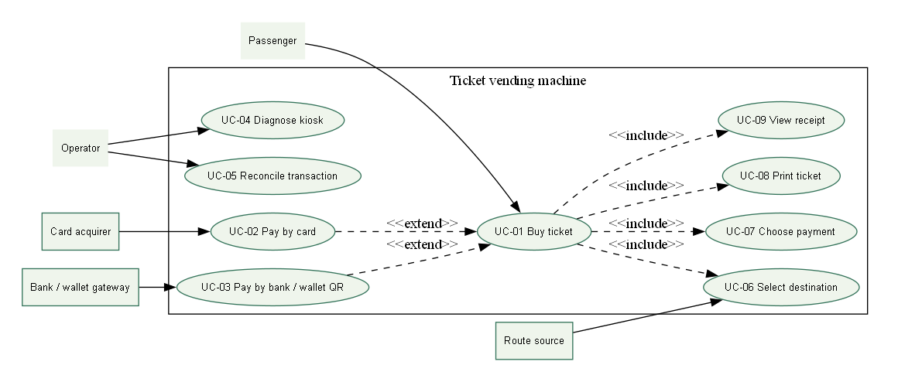

#### 3.1.2 Actors and Use Case List

| Actor | Responsibility |
|---|---|
| Passenger | Choose destination/payment; buy and view a ticket |
| Operator | Diagnose and supervise reconciliation or compensation |
| Card / bank / wallet gateway | Production payment boundary; simulated in demo |
| Route source | Active route catalogue; SQL in this demo |

| Use case | Scope |
|---|---|
| UC-01 Buy ticket | Designed; prototype scope stated below |
| UC-02 Pay by card | Designed; prototype scope stated below |
| UC-03 Pay by bank / wallet QR | Designed; prototype scope stated below |
| UC-04 Diagnose kiosk | Designed; prototype scope stated below |
| UC-05 Reconcile transaction | Designed; prototype scope stated below |
| UC-06 Select destination | Designed; prototype scope stated below |
| UC-07 Choose payment | Designed; prototype scope stated below |
| UC-08 Print ticket | Designed; prototype scope stated below |
| UC-09 View receipt | Designed; prototype scope stated below |

#### 3.1.3 Use Case Descriptions

##### UC-01 Buy ticket

| Field | Description |
|---|---|
| Actor | Passenger |
| Trigger | Passenger requests the journey action |
| Preconditions | Kiosk ready, route data and printer available. |
| Main success flow | Start; select route; confirm fare; choose method; authorize; persist; print; show receipt. |
| Alternate / exception | Decline allows retry; timeout requires reconciliation; print fault creates compensation case. |
| Postcondition | At most one delivered ticket for a paid transaction. |

##### UC-02 Pay by card

| Field | Description |
|---|---|
| Actor | Passenger |
| Trigger | Passenger requests the journey action |
| Preconditions | Route and fare confirmed. |
| Main success flow | Prompt tap or insert; send tokenized authorization; verify outcome. |
| Alternate / exception | Decline, cancel, or timeout returns a safe status. |
| Postcondition | Payment reference linked to transaction. |

##### UC-03 Pay by bank / wallet QR

| Field | Description |
|---|---|
| Actor | Passenger |
| Trigger | Passenger requests the journey action |
| Preconditions | Route and fare confirmed. |
| Main success flow | Create expiring amount-bound QR; display; await signed callback. |
| Alternate / exception | Expiry or cancellation invalidates QR; late callback requires reconciliation. |
| Postcondition | A confirmed capture or no issued ticket. |

##### UC-04 Diagnose kiosk

| Field | Description |
|---|---|
| Actor | Operator |
| Trigger | A fault or unknown transaction needs resolution |
| Preconditions | Authenticated operator and service mode. |
| Main success flow | Check printer, network, gateway, and recent faults. |
| Alternate / exception | Failed self-test sets out-of-service state. |
| Postcondition | Audited diagnostic event. |

##### UC-05 Reconcile transaction

| Field | Description |
|---|---|
| Actor | Operator |
| Trigger | A fault or unknown transaction needs resolution |
| Preconditions | Payment result unknown or print compensation pending. |
| Main success flow | Query gateway; compare capture; retry print or refund. |
| Alternate / exception | Gateway unavailable remains queued. |
| Postcondition | No duplicate charge or ticket. |

##### UC-06 Select destination

| Field | Description |
|---|---|
| Actor | Passenger |
| Trigger | Passenger requests the journey action |
| Preconditions | Active fare catalogue available. |
| Main success flow | Show active routes; select destination and fare snapshot. |
| Alternate / exception | Missing or stale catalogue shows unavailable guidance. |
| Postcondition | Valid route and fare assigned. |

##### UC-07 Choose payment

| Field | Description |
|---|---|
| Actor | Passenger |
| Trigger | Passenger requests the journey action |
| Preconditions | Route and fare confirmed. |
| Main success flow | Choose card, bank QR, or wallet. |
| Alternate / exception | Cancel or timeout discards pending selection. |
| Postcondition | One method set for the attempt. |

##### UC-08 Print ticket

| Field | Description |
|---|---|
| Actor | Passenger |
| Trigger | Passenger requests the journey action |
| Preconditions | Confirmed payment and working printer. |
| Main success flow | Generate unique opaque barcode; print route, fare, validity, and barcode. |
| Alternate / exception | Printer fault creates reprint or refund case. |
| Postcondition | Ticket linked to one paid transaction. |

##### UC-09 View receipt

| Field | Description |
|---|---|
| Actor | Passenger |
| Trigger | Passenger requests the journey action |
| Preconditions | Payment and print results known. |
| Main success flow | Show route, fare, time, reference, and support guidance. |
| Alternate / exception | Unknown payment shows pending guidance, not success. |
| Postcondition | Passenger can identify transaction for support. |

### 3.2 Activity Diagrams (10 marks)

#### 3.2.1 Passenger Buys a Ticket at the TVM

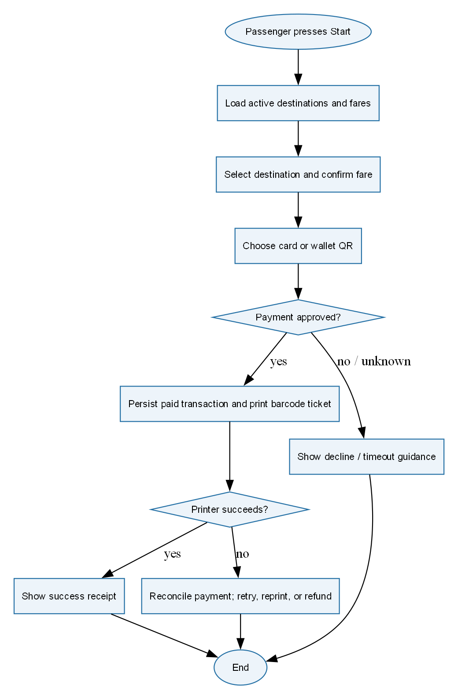

#### 3.2.2 Communication with External Payment Gateways

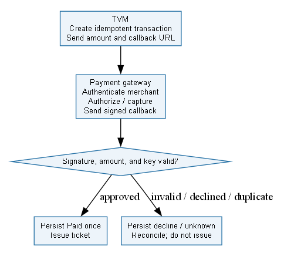

### 3.3 Detailed System Modeling: Main Use Case "Buy a Ticket" (15 marks)

#### 3.3.1 Sequence Diagram

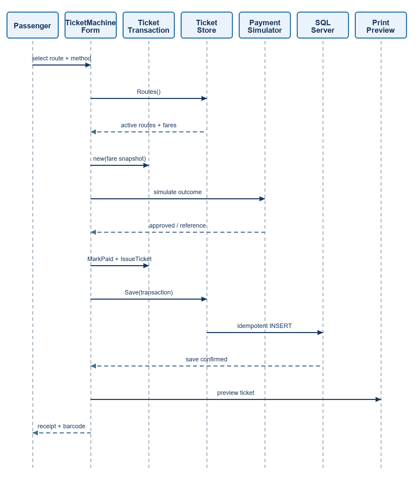

#### 3.3.2 State Chart Diagram

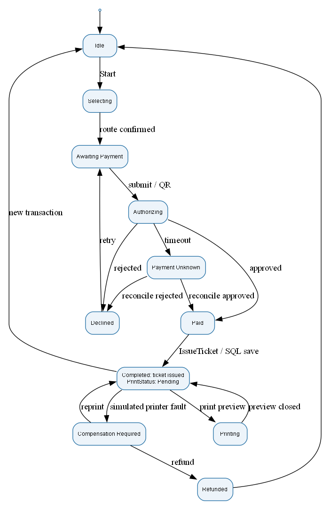

#### 3.3.3 Class Diagram (Domain Model)

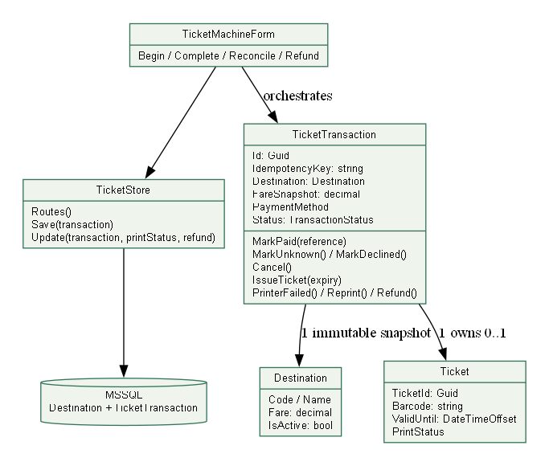

### 3.4 Model Consistency Check

| Cross-check | Evidence / result |
|---|---|
| Requirements → use cases | UC-01 and FR-01..07 cover route, payment, ticket and recovery |
| Class → code | TicketTransaction, Destination, Ticket, TicketStore and current methods match the implementation |
| State → tests | Unknown cannot issue; duplicate payment is idempotent; reprint retains barcode |
| Payment choices | Card, BankQr and Wallet are present in enum, UI and SQL constraint |
| Architecture → scope | Signed callbacks, live providers, startup reconciliation and authenticated diagnostics are production extensions |
| Printing | Preview does not claim physical delivery; failed printer simulation enters compensation |

## 4. Phase 3: UI/UX & Architecture (15 marks)

### 4.1 UI/UX Design (5 marks)

The interface presents a three-step progress indicator, large selectors, persistent fare, explicit error/unknown guidance and a separate ticket surface. The visual upgrade adds original 3D artwork, a subtle seven-color animated frame, three coordinated palettes, gentle button feedback and a silent 30-second motion graphic with a pause control. Payment and recovery controls remain available independently of animation. An unavailable route catalogue exposes Retry connection. An unconfirmed SQL save blocks reset and a new journey until the same reference is resolved. The refreshed Forest theme was launched against SQLEXPRESS for the final demo capture and displayed all 15 active destinations.

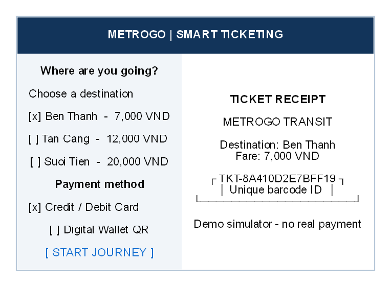

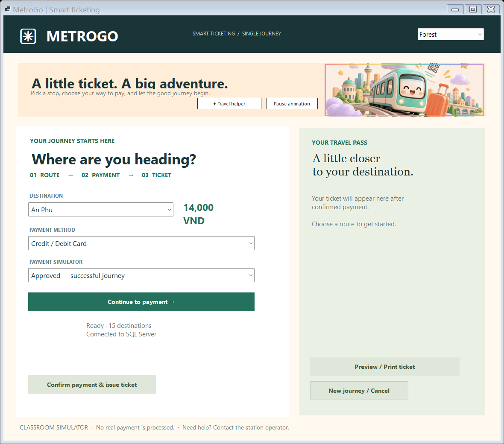

The optional local AI guide uses TF-IDF retrieval over curated English and Vietnamese workflow answers. Forest, Sunset and Lilac palettes update the banner, labels, receipt surface and action buttons together. Hover and pressed feedback do not change fare or payment behavior. The guide cannot charge money or alter transactions. Seven additional tests verify the local assistant. An editable MetroGo frame and both Lab 2 sign-in frames are in the Figma handoff: https://www.figma.com/design/XJaFLoJzp8NrexLNmOHBAk.

### 4.2 Architectural Design (10 marks)

#### 4.2.1 Architecture Diagram

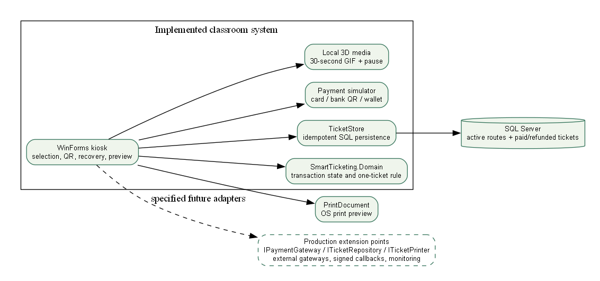

SmartTicketing.Domain owns transaction transitions and unique ticket identity. TicketStore loads active routes and saves with a serializable same-reference check. TicketMachineForm orchestrates simulator outcomes and displays the QR/receipt only when persistence confirms. IPaymentGateway, ITicketRepository and ITicketPrinter specify production adapter boundaries.

#### 4.2.2 Deployment Diagram

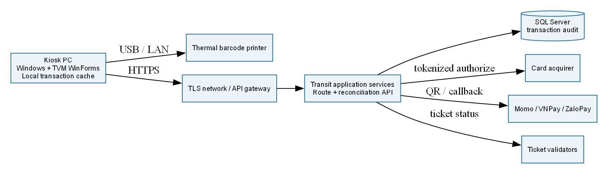

## 5. Phase 4: Implementation, Tooling & Demo (30 marks)

### 5.1 Visual Studio Engineering: Model-to-Code (10 marks)

#### 5.1.1 Forward Engineering (Model to Code)

tools/ModelEngineering reads domain-model.json and writes engineering/ModelSkeletons.cs. This is a reproducible forward-engineering artifact. It does not claim the Visual Studio designer command was executed.

#### 5.1.2 Backward Engineering (Code to Model)

The tool reflects the compiled domain assembly into engineering/CodeToModel.json. The current immutable properties and state/recovery methods can be compared with the forward model.

#### 5.1.3 Code Map

engineering/DomainCodeMap.dgml contains reflected property dependencies from the actual assembly. Open it in supporting Visual Studio graph tooling. Actual Visual Studio operations and screenshots still require capture in a supporting installed edition; see docs/visual-studio-demo.md.

### 5.2 GitHub & AI Tooling (10 marks)

#### 5.2.1 Source Control

Confirmed GitHub account: https://github.com/Nghiaktvn. The account URL is not a project repository. No genuine group repository, branch/PR history or contribution figures have been supplied. Local main has no commits. The proposed workflow uses feature branches, student-authored commits, peer review and Pull Requests into main; no historical teamwork is invented.

#### 5.2.2 AI Assistance: Copilot Prompt Documentation

| Tool / date | Actual request summary | Kept / changed | Validation |
|---|---|---|---|
| Codex / 23 Oct 2026 | Complete PDFs and rubric | Code, tests, workbook and numbered report | Build, MSTest and SQL demo |
| Codex / 23 Oct 2026 | Upgrade all UI/UX and functional demos | Three application interfaces and safe workflow states | Native and browser captures |
| image_gen / 23 Oct 2026 | Joyful MetroGo 3D transit scene | Original art + 30-second motion graphics | Image inspection; video metadata |

#### 5.2.3 Reflection on AI Use

AI accelerated scaffolding, but review exposed account lockout, cancellation, stale-stock and template-compliance gaps. These were corrected and tested. Students must understand the submitted code; prompts, assumptions and generated art are declared.

### 5.3 Demo Application (10 marks)

| Input / action | Observed or enforced result |
|---|---|
| Route choice | Active SQL catalogue and immutable fare snapshot |
| Card / Bank QR / Wallet | Labeled simulator terminal or transaction-bound QR |
| Confirm payment | Explicit confirmation saves one Paid ticket; no external provider or real charge |
| Approved | One saved ticket and barcode |
| Declined | No usable ticket; retry possible |
| Timeout | Unknown state; reconcile before a fresh payment |
| Uncertain save | Retry the same reference without duplicate ticket |
| Printer fault | Same-ticket recovery or recorded simulated refund |
| Print | PrintDocument preview; optional OS print |

21 meaningful domain tests passed. The live simulator demo confirmed An Phu at 14,000 VND and saved one Paid ticket with a valid expiry. The captured screen shows the confirmation state and ticket barcode. Card/bank/wallet authorization, reconciliation and refund remain simulations. Physical paper output is not tested.

The final 18-check WinForms button audit exercised the actual event handlers offline, including card success, both QR methods, decline, timeout reconciliation, printer-fault refund/recovery, reset, pause/theme and guide opening. The separate 5-check SQL harness proved ticket persistence and fixture cleanup. SQL Express AUTO_CLOSE was disabled after the Windows log showed repeated database recovery; the final combined test passed at a 15-second connection timeout. Evidence is in docs/evidence/tvm-button-audit.json and the integration log. The print control was checked as enabled with a paid ticket; physical print output was not tested.

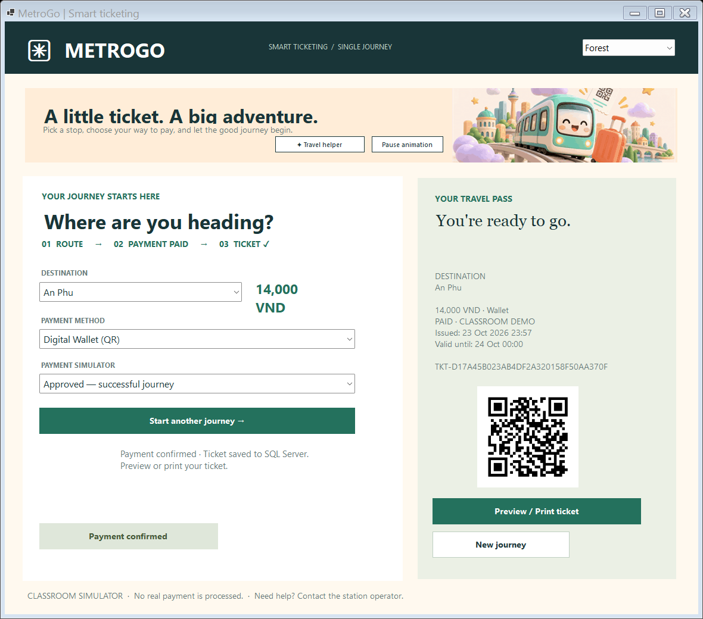

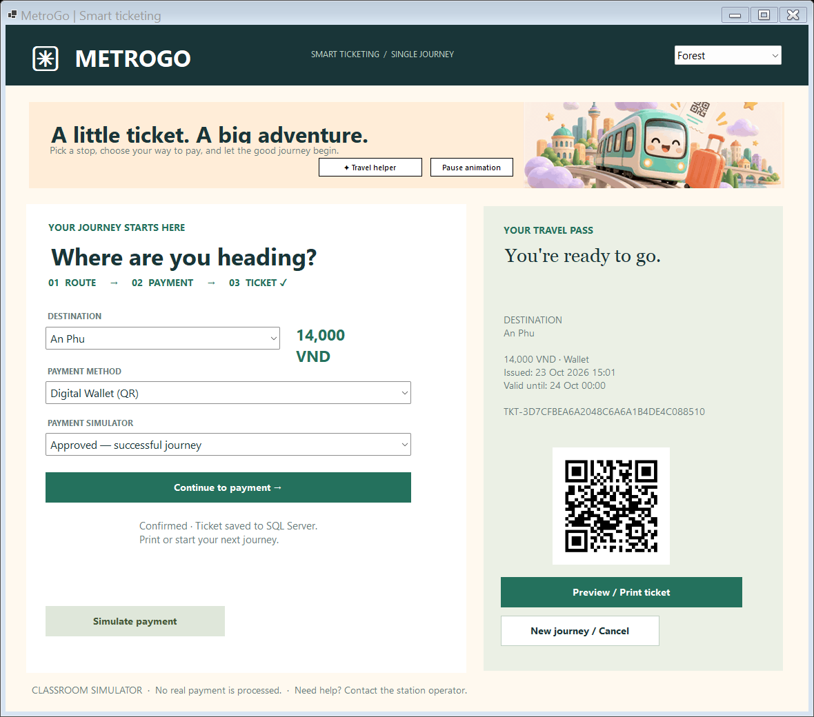

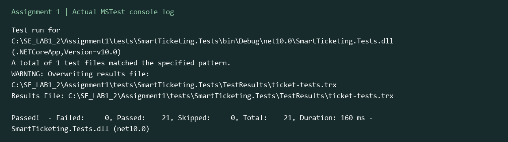

## 6. Checklist for "LabGroup_QT2_Assignment1.pdf"

| Supplied rubric task | Section | Status |
|---|---|---|
| Clarification Q&A | 2.1 | Artifact verified |
| Requirements specification | 2.2 | Artifact verified |
| Use cases | 3.1 | Artifact reviewed |
| Activity diagrams | 3.2 | Artifact reviewed |
| Detailed system modeling | 3.3 | Current class/state/sequence reviewed |
| UI/UX | 4.1 | Built and visually checked |
| Architecture | 4.2 | Demo/production boundaries stated |
| Visual Studio engineering | 5.1 | Generated artifacts; actual VS captures pending |
| GitHub and AI tooling | 5.2 | AI log supplied; genuine group GitHub history pending |
| C# and MSSQL demo | 5.3 | 21 domain tests; SQL-connected demo |

The separate Assignment 1 brief referenced by the template was not among the five supplied files. This checklist audits the supplied report/workbook templates and does not assert review of an unavailable additional brief.

## 7. Contribution of Each Member

| Member | Student ID | Actual responsibilities | Contribution |
|---|---|---|---|
| Phạm Trung Nghĩa | 524H0172 | Confirmed submission contact; feature ownership pending group confirmation | Pending |
| Remaining 2–4 members | Not supplied | Group must provide real names and ownership | Pending |

Percentages must total 100% across 3–5 actual members and match readme.txt. Only one confirmed member was provided, so the remaining names and percentages are left for the group.

## References

Supplied assignment/report/workbook PDFs; submitted C# source, SQL script and actual evidence. The design folder records original image prompts, media source and photo credits.

## Appendix A: readme.txt

SMART TICKETING — ASSIGNMENT 1
Confirmed member: Phạm Trung Nghĩa — 524H0172
GitHub account: https://github.com/Nghiaktvn
Project repository: pending (an account profile is not a repository/PR record).
Group number, remaining 2–4 real members, actual feature ownership, contribution percentages: pending group confirmation.
The contribution percentages must total 100% and match the report and A1_Team_Workbook.xlsx.
Setup:
1. Install .NET SDK 10, Windows Desktop runtime and SQL Server.
2. Run database/01_create_database.sql using sqlcmd or SSMS. It is repeatable and preserves existing records.
3. Set ConnectionStrings:Ticketing in src/SmartTicketing.WinForms/appsettings.json, or environment ConnectionStrings__Ticketing.
4. dotnet build SmartTicketing.sln
5. dotnet run --project src/SmartTicketing.WinForms
6. dotnet test tests/SmartTicketing.Tests
7. dotnet run --project tools/ModelEngineering -- <absolute Assignment1 folder>
All card, bank-QR, wallet, timeout, reconciliation and refund outcomes are simulations. No real payment occurs.
The 30-second MP4/GIF and original artwork are local assets. Pause animation in the kiosk when desired.
Actual Visual Studio model/code operations and Code Map screenshots still require capture on a supporting installed edition.
Report.docx is also supplied as 524H0172_PhamTrungNghia.docx.
SourceCode.zip excludes bin, obj, TestResults and local secrets; saved evidence is under docs/evidence.

## Appendix B: Full-size Diagrams

Full-size PNG and editable DOT sources are under docs/diagrams; the production PlantUML specification is in docs/uml.md. Original art and 30-second MP4/GIF media are under assets.
