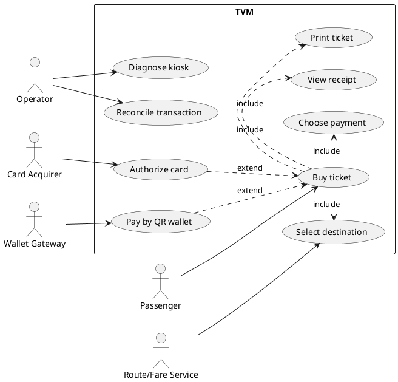
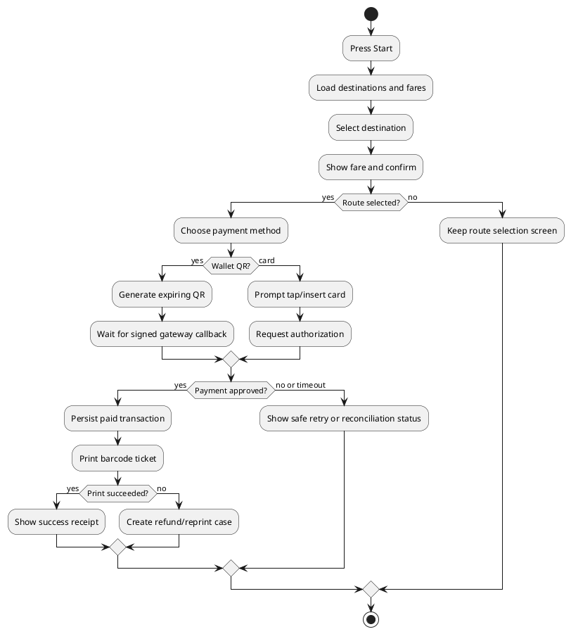
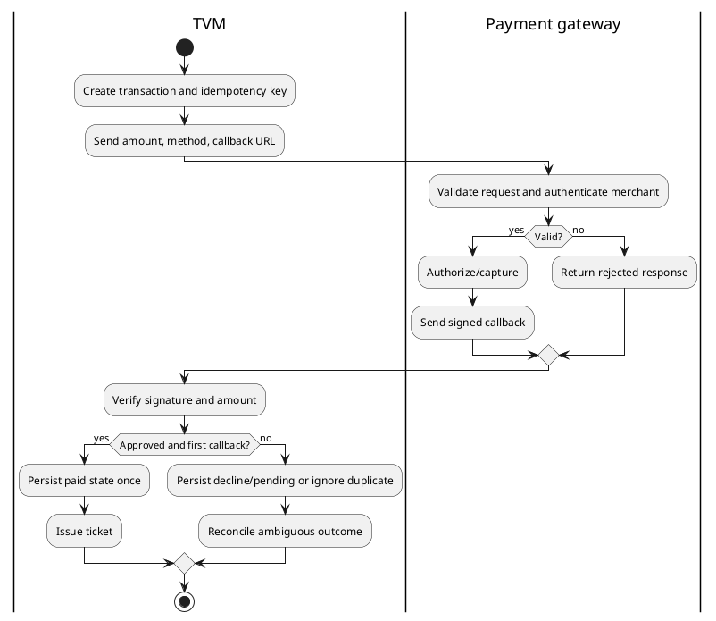
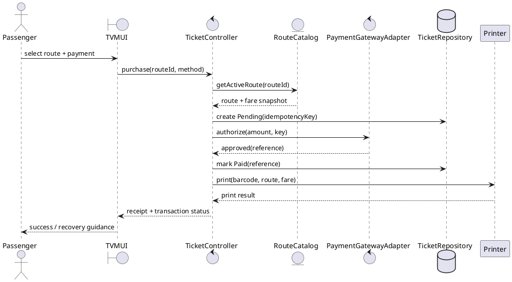
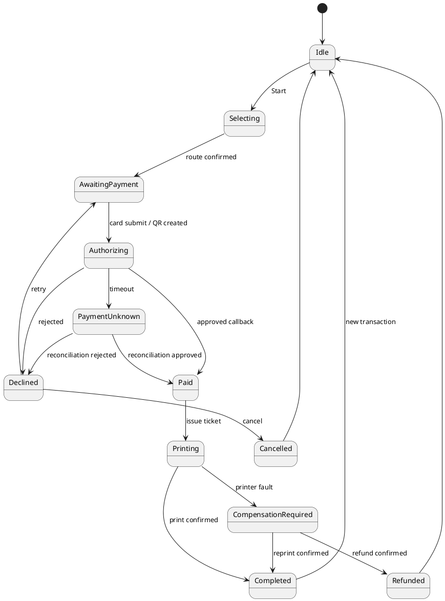

# UML Design Source

The PlantUML blocks below preserve the production specification. The current implemented class, architecture, state and sequence diagrams are generated from the .dot / build_sequence.py sources in docs/diagrams. Production gateway callbacks, startup reconciliation and authenticated diagnostics remain extension requirements; they are not represented as live integrations in the demo.

## Use case diagram


## Use case descriptions

| Use case | Preconditions | Main flow | Alternate/error flow | Postcondition |
|---|---|---|---|---|
| UC-01 Buy ticket | Kiosk online, printer ready, route data available. | Start; select route; confirm fare; choose card or wallet; authorize; persist paid state; print barcode ticket; display receipt. | Decline: show retry; timeout: mark unknown and reconcile; printer fault: open compensation case, no delivered ticket. | One paid transaction and at most one issued ticket. |
| UC-02 Pay by card | UC-01 route and fare confirmed. | Prompt tap/insert; send tokenized request; receive signed outcome. | Decline, cancel, or timeout returns to safe payment screen. | Payment reference linked to transaction. |
| UC-03 Pay by wallet QR | UC-01 route and fare confirmed. | Create expiring amount-bound QR; display; await callback; verify signature and idempotency. | Expiry/cancel invalidates QR; late callback enters reconciliation. | Single confirmed capture or no ticket. |
| UC-04 Diagnose kiosk | Operator authenticated; kiosk service mode. | Inspect status, connectivity, printer, and recent error events; acknowledge issue. | Failed self-test sets kiosk out of service and alerts support. | Audited diagnostic action. |
| UC-05 Reconcile transaction | Transaction marked unknown or printer compensation pending. | Query gateway; compare capture; retry print or initiate reversal/refund. | Gateway unavailable remains queued with retry schedule. | State converges without duplicate charge or ticket. |
| UC-06 Select destination | Kiosk ready and active fare catalogue available. | Display active destinations, passenger chooses one, show fare snapshot. | No route or stale catalogue: show unavailable state and operator guidance. | A valid route and fare are attached to the pending purchase. |
| UC-07 Choose payment | Route and fare have been confirmed. | Display supported card and wallet options; passenger chooses one. | Passenger cancels or times out: discard pending selection. | One payment method is fixed for this attempt. |
| UC-08 Print ticket | Confirmed paid transaction and functioning printer. | Generate unique opaque barcode and print route, fare, validity, and barcode. | Printer fault: record failure and create reprint/refund case. | Printed ticket is linked to exactly one paid transaction. |
| UC-09 View receipt | Payment and print results are known. | Show transaction ID, destination, fare, time, masked payment reference, and support route. | Unknown gateway result: show pending guidance without success claim. | Passenger can identify the transaction for support. |

## Passenger purchase activity


## Gateway integration activity


## Sequence diagram


## State chart


## Class diagram
```plantuml
@startuml
class TicketMachine { +Start() +SelectRoute(id) +Purchase(method) }
class TicketTransaction { +Id: Guid +FareSnapshot: decimal +Status: TransactionStatus +IdempotencyKey: string +CreatedAt: DateTimeOffset }
class Destination { +Code: string +Name: string +Fare: decimal +IsActive: bool }
class Ticket { +TicketId: Guid +Barcode: string +ValidUntil: DateTimeOffset +PrintStatus: PrintStatus }
interface IPaymentGateway { +Authorize(request): PaymentResult +Reconcile(reference): PaymentResult }
interface ITicketRepository { +Save(transaction) +Find(id) }
interface ITicketPrinter { +Print(ticket): PrintResult }
class CardGatewayAdapter
class WalletGatewayAdapter
class PurchaseService
TicketMachine --> PurchaseService
PurchaseService --> IPaymentGateway
PurchaseService --> ITicketRepository
PurchaseService --> ITicketPrinter
TicketTransaction "1" *-- "0..1" Ticket
TicketTransaction --> Destination : fare snapshot
IPaymentGateway <|.. CardGatewayAdapter
IPaymentGateway <|.. WalletGatewayAdapter
@enduml
```

## Architecture and deployment
```plantuml
@startuml
package "TVM Kiosk" { [WinForms Touch UI] --> [Purchase Application] --> [Domain Model]; [Purchase Application] --> [Gateway Adapters]; [Purchase Application] --> [SQL Repository]; [Purchase Application] --> [Printer Adapter] }
[Gateway Adapters] --> cloud "Card Acquirer API"
[Gateway Adapters] --> cloud "Momo / VNPay / ZaloPay APIs"
[SQL Repository] --> database "Ticketing SQL Server"
[Purchase Application] --> cloud "Route/Fare API"
[Printer Adapter] --> node "Barcode ticket printer"
node "Kiosk PC" { [WinForms Touch UI]; [Purchase Application] }
@enduml
```

## UI wireframe

See `ui-mockups.html`, a responsive touchscreen mockup corresponding to the WinForms demo screens.
