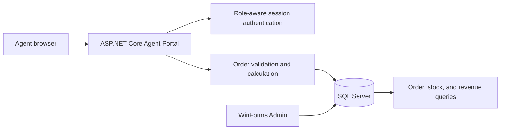
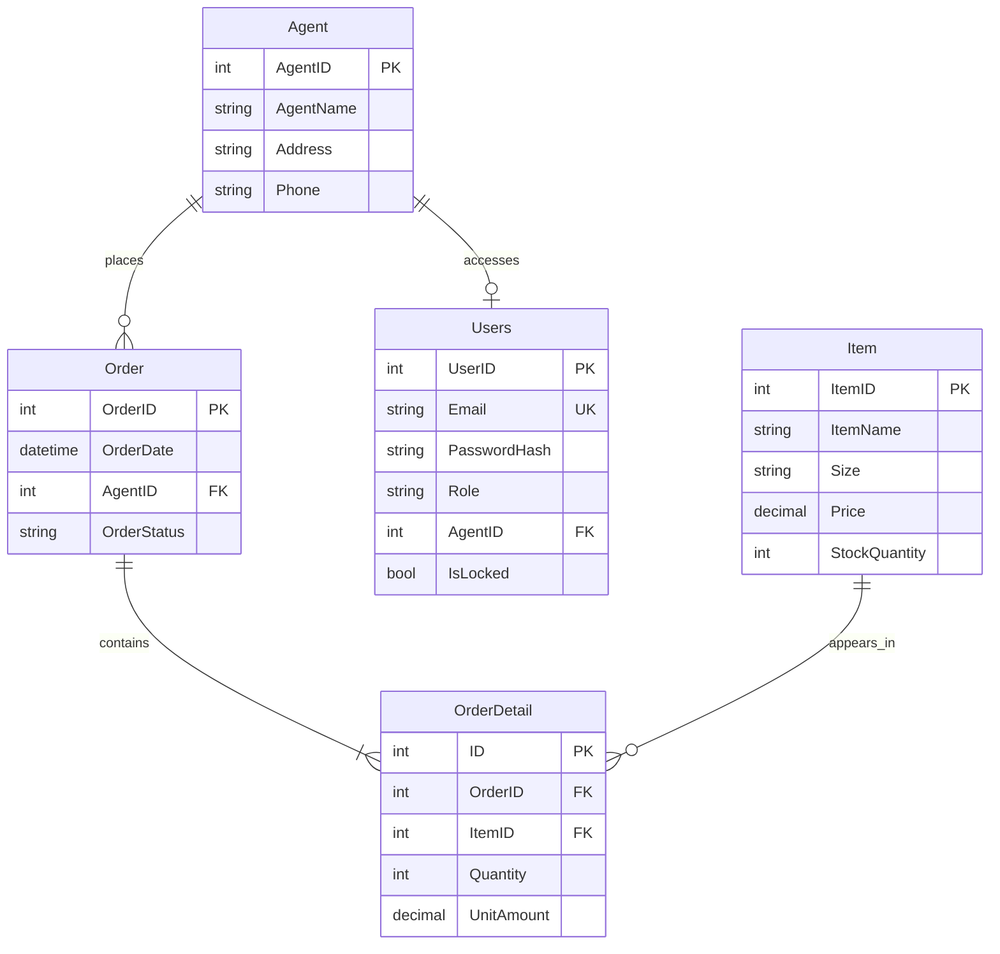

# Wholesale System Design

## Selected web option

Option B (ASP.NET Core Web App with Razor Pages) is selected. The project has Razor Pages for login, catalog, order history, and printable invoice. Page models call a scoped SQL data service; the responsive views use a shared layout and stylesheet.

## Architecture

The agent purchase path starts one serializable SQL transaction, locks selected stock rows in ItemID order, checks all quantities, inserts one order and multiple details, deducts all quantities, and commits. Any failure rolls back all changes. The database check constraint prevents negative stock even if a caller bypasses UI validation.

## ER diagram

## Deployment

The portal and desktop administrator run on authenticated operator devices. Both connect over a protected internal network to SQL Server. Production deployment requires HTTPS, managed secrets, least-privilege database identities, password hashes from an approved implementation, anti-forgery tokens, rate limiting, and audited role changes.

## Admin features

The WinForms application includes Admin-role sign-in, SQL-backed item and agent add/edit/soft-deactivate forms, item stock updates, order status progression, shipping manifest preview, low-stock warnings, and best-seller/revenue dashboard. Both applications use the same SQL Server database.
