# B2B Wholesale Management System — Assignment 2

Phạm Trung Nghĩa (524H0172) · 23 October 2026. Full group roster and contributions await confirmation.

## 1. Introduction

### 1.1 System Overview

Northstar Wholesale connects an Admin WinForms warehouse workspace, an ASP.NET Core Razor Pages Agent Portal and MSSQL. Admins manage stock, partners and dispatch; agents place multi-product orders, follow statuses and print invoices. A classroom-only invoice action records payment state without contacting a provider or moving money. The visual upgrade adds an original public collection page, 3D art, local ingredient photography and optional silent 30-second motion graphics.

### 1.2 Tasks and Division of Labor

| Task | Feature | Actual owner | Evidence |
|---|---|---|---|
| DB | Database and integrity | Pending group confirmation | Schema/seed and SQL verified |
| 1.1 | Admin login | Pending group confirmation | Role and lockout SQL checks |
| 1.2 | Item, Agent and Order management | Pending group confirmation | CRUD, row version and stock SQL checks |
| 1.3 | Shipping manifest | Pending group confirmation | HTML export and print stylesheet verified |
| 1.4 | Dashboard and filters | Pending group confirmation | SQL agent/date filters verified |
| 3.1 | Agent login | Pending group confirmation | Browser and SQL checks |
| 3.2 | Master-detail transaction | Pending group confirmation | Rollback/replay/concurrency verified |
| 3.3 | My Orders and invoice | Pending group confirmation | Browser, ownership, paid-status and invoice checks |
| 3.4 | Responsive UI | Pending group confirmation | Desktop and 304px view checked |
| 5.1 | Meaningful unit tests | Pending group confirmation | 26/26 passed |
| 6a | Configuration | Pending group confirmation | External config files used |
| 6b | Git collaboration | Pending group confirmation | Actual repository and PR history pending |
| 6c | Professional report | Pending group confirmation | Generated; full team record pending |


### 1.3 Team Members

| Member | Student ID | Actual responsibilities | Contribution |
|---|---|---|---|
| Phạm Trung Nghĩa | 524H0172 | Confirmed submission contact; feature ownership pending group confirmation | Pending |
| Remaining 2–4 members | Not supplied | Group must provide real names and ownership | Pending |


## 2. Environment and How to Run

| Item | Configuration / command |
|---|---|
| Runtime | Windows; .NET SDK 10 with Desktop and ASP.NET runtime |
| Database | SQL Server / SQLEXPRESS; WholesaleManagement |
| Setup script | database/01_create_database.sql; repeatable additive upgrade preserving existing records |
| Admin config | src/Wholesale.AdminWinForms/App.config |
| Portal config | src/AgentPortal/appsettings.json; environment override ConnectionStrings__Wholesale |
| Startup | Wholesale.AdminWinForms; AgentPortal at http://127.0.0.1:5400 |
| Demo Admin | admin / Demo123! (classroom account) |
| Demo Agent | agent01@wholesale.local / Demo123! (classroom account) |
| Unit tests | dotnet test tests/Wholesale.Tests |
| SQL integration | dotnet run --project tests/Wholesale.IntegrationTests -- <absolute Assignment2 directory> |


## 3. Database Configuration & Seed Data (10 marks)

### 3.1 Database Diagram

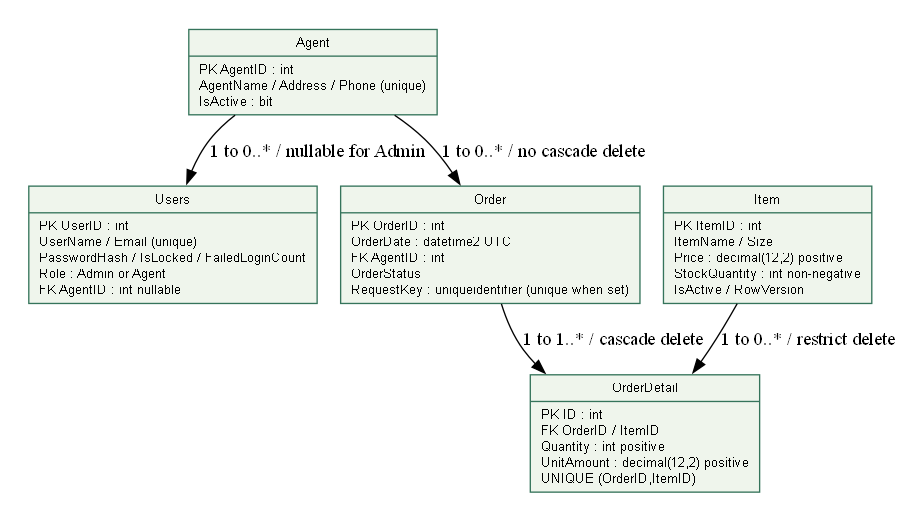

### 3.2 Schema

| Table | Columns and types | Keys / checks |
|---|---|---|
| Item | ItemID int; ItemName nvarchar(120); Size nvarchar(30); Price decimal(12,2); StockQuantity int; IsActive bit; RowVersion rowversion | PK; positive price; nonnegative stock |
| Agent | AgentID int; AgentName nvarchar(120); Address nvarchar(250); Phone nvarchar(25); IsActive bit | PK; unique phone |
| Order | OrderID int; OrderDate datetime2 UTC; AgentID int; OrderStatus nvarchar(20); RequestKey uniqueidentifier nullable; PaymentStatus nvarchar(16); PaidAtUtc datetime2 nullable; PaymentReference nvarchar(80) nullable | PK; FK Agent; status/payment CHECKs; unique RequestKey and payment reference when set |
| OrderDetail | ID int; OrderID int; ItemID int; Quantity int; UnitAmount decimal(12,2) | PK; two FKs; unique order/item; positive qty/price |
| Users | UserID int; UserName nvarchar(80); Email nvarchar(254); PasswordHash nvarchar(255); IsLocked bit; Role nvarchar(20); AgentID int nullable; FailedLoginCount int | PK; unique account/email; FK Agent; role-agent compatibility CHECK |


### 3.3 Seed Data (5 marks)

| Table | Seed rows | Realistic variation |
|---|---|---|
| Item | 15 | Coffee, tea, pantry goods; cashews at 8 for low-stock warning |
| Agent | 15 | Vietnamese retailer names, delivery addresses and dummy unique phones |
| Order | 15 | Varied dates and Pending/Processing/Shipped statuses |
| OrderDetail | 15 | Price snapshots and positive quantities |
| Users | 16 | 1 Admin + 15 Agents; salted PBKDF2 hashes |


Every table has 15–30 rows in the seed script. Live counts grow when demo orders are placed. The multi-item browser order #23 contains two lines totaling 1,045,000 VND and now has a Paid classroom-simulator reference. The one-product payment demonstration is order #55: one Arabica Coffee Beans line at 245,000 VND, also marked Paid. Uniquely named SQL test fixtures are cleaned up after verification; rolled-back transactions can still advance identity numbers.

### 3.4 Integrity (5 marks)

| Rule | Implementation | Reason |
|---|---|---|
| Order → Agent | FK, no cascade delete; soft deactivation | Retain order history |
| Detail → Order | FK ON DELETE CASCADE | Master/detail lifecycle |
| Detail → Item | FK restrict delete; soft deactivation | Preserve historic product references |
| Stock / money | CHECK stock >=0; quantity, price and amount >0 | Reject invalid values |
| Accounts | Unique username/email; role-agent CHECK | Prevent duplicate identity and invalid role association |
| Duplicate checkout | Unique RequestKey when non-null | One order per submission reference |
| Demo payment | Status CHECK, audit CHECK, unique payment reference, and locked owner-only update | One paid invoice per classroom confirmation; cancellation records Refunded |
| Stale editor | RowVersion compare-and-update | Do not overwrite concurrent web stock deductions |
| Cancellation | Status and stock restoration in one transaction | Return reservations once only |


## 4. Exercise 1: Back-Office Windows Application (25 marks)

### 4.1 Task 1.1: Secure Login Form (5 marks)

Only unlocked Admin users authenticate. Both applications use a shared salted PBKDF2 SHA-256 verifier with bounded hash parameters and constant-time comparison. A serializable login update increments failures and locks on the fifth incorrect password. Integration tests use a separate Admin fixture, leaving the seeded Admin available.

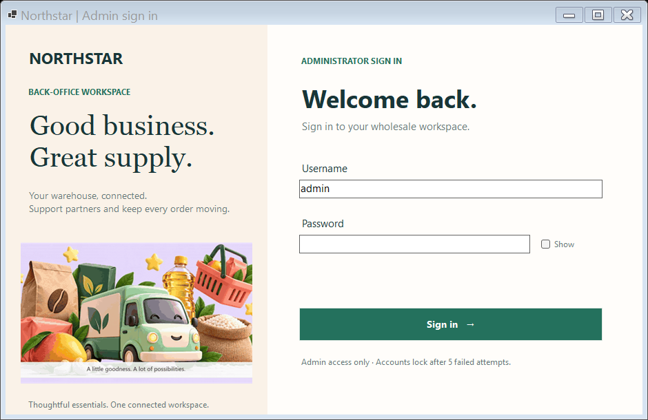

### 4.2 Task 1.2: Item, Agent and Order Management (10 marks)

Sidebar navigation, KPI cards, searchable grids and explicit actions support product add/edit/deactivation, signed stock adjustments, transactional company-and-login registration, company editing, Agent unlock and safe deactivation. Pending → Processing → Shipped transitions and pre-shipment cancellation are validated. Cancellation restores every line atomically and a repeated/stale cancellation cannot return stock twice.

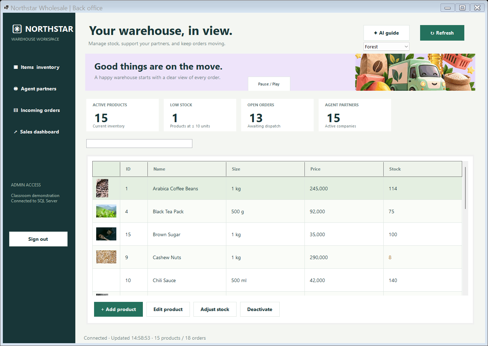

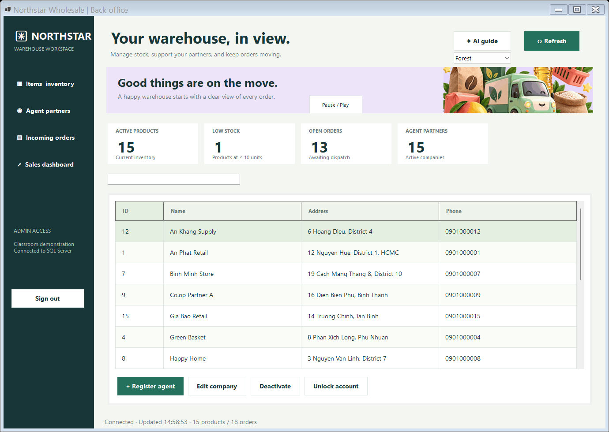

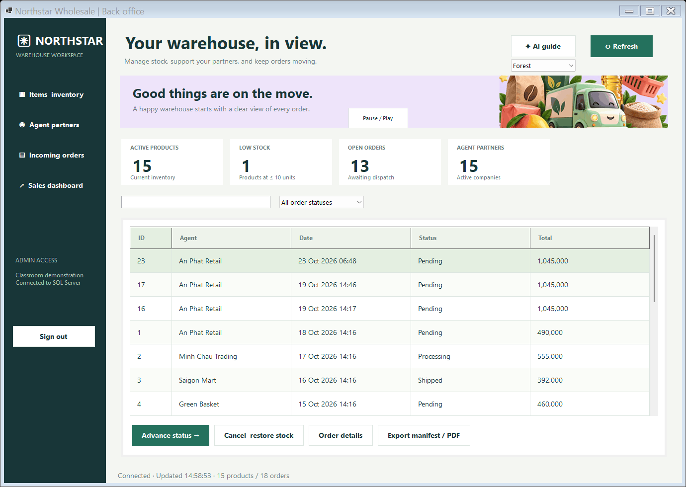

### 4.3 Task 1.3: Shipping Manifest Report (5 marks)

Selected orders have details and native multi-page print preview. HTML export includes escaped delivery name, address, phone, status, date, product quantities, unit prices, amounts, total and signature lines. Open the export and choose Print / Save as PDF. A verified sample is bundled in docs/evidence/sample-shipping-manifest.html; the SQL harness checks address, total and print stylesheet.

### 4.4 Task 1.4: Data Filter and Dashboard (5 marks)

Filters select an agent and inclusive date range. Best sellers aggregate non-cancelled ordered quantities; low stock lists active products at ten units or below; revenue aggregates shipped orders only. SQL is parameterized, and the revenue definition is stated in the view.

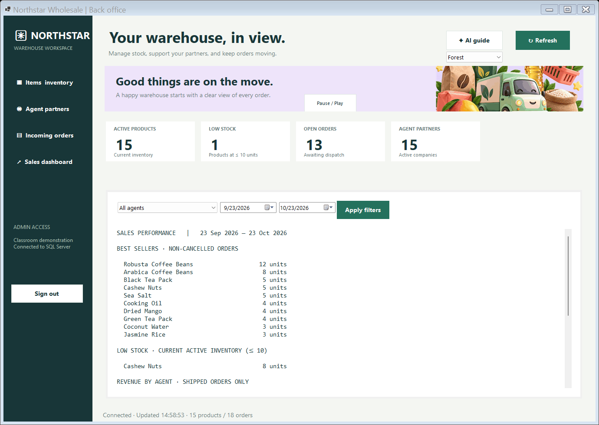

## 5. Web Application: Agent Portal (35 marks)

### 5.1 Option Chosen

Option B (Exercise 3): ASP.NET Core Razor Pages. Server-rendered forms and built-in antiforgery handling fit this workflow. Projects target .NET 10; Microsoft.Data.SqlClient is pinned at 6.1.3. Unit tests use MSTest 3.10.2.

### 5.2 Task 3.1: Web Login Form (5 marks)

Only active unlocked Agent users sign in. Admin credentials and wrong passwords receive a generic rejection. Five failures lock an account. Sessions are revalidated against the signed-in account/agent and cleared on logout. Forms use antiforgery tokens; session cookies are HttpOnly and SameSite Lax.

The final sign-in view follows the supplied Notezy reference's two-panel composition, with a seven-color NORTHSTAR wordmark, a 30-second Nova product film and a separate credential card. The final branding removes the previous logo icon and subtitle. The film's pause control, password visibility toggle, demo-access disclosure, theme selector and global motion pause were checked in the local browser after the final rebuild. Authentication, validation and role checks remain unchanged. Native editable screens for the portal and WinForms Admin are in the Figma handoff: https://www.figma.com/design/XJaFLoJzp8NrexLNmOHBAk.

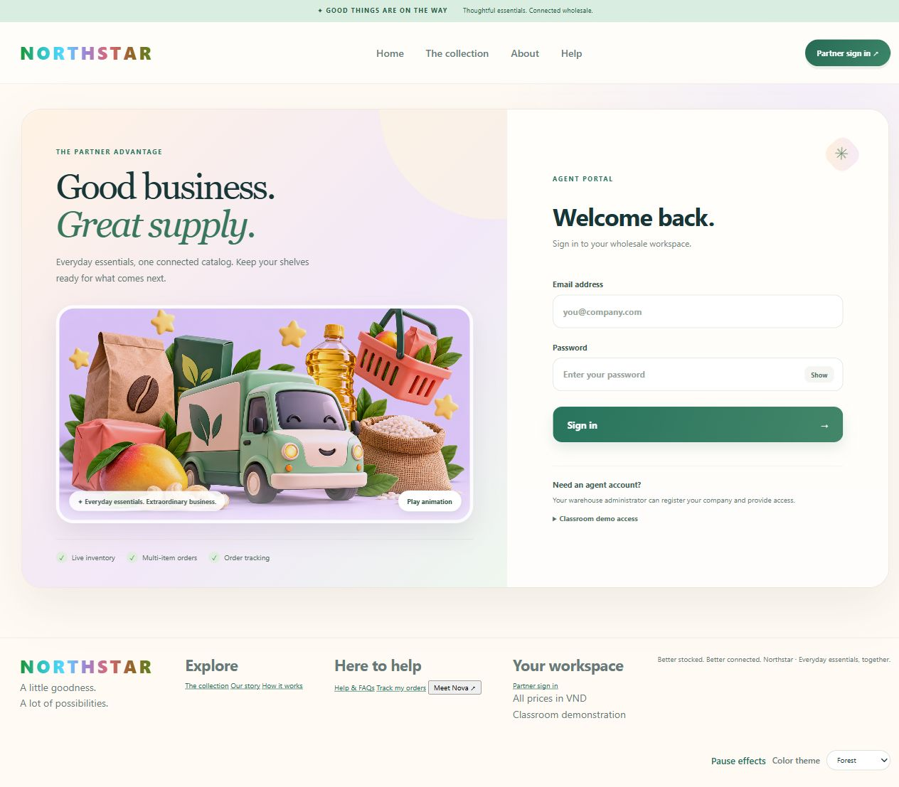

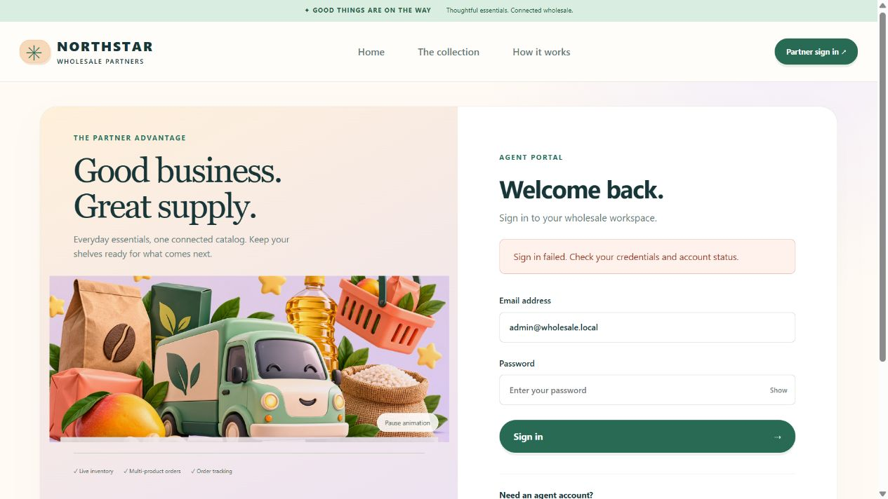

### 5.3 Task 3.2: Catalog and Master-Detail Order (15 marks, core business logic)

Card/list views, category and text filters, quantity steppers and a live summary help build multi-product orders. The server validates all quantities again, reads SQL prices and snapshots them; it never trusts the client total.

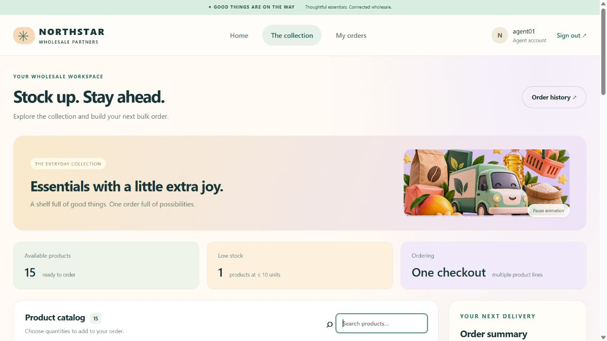

Transaction logic

```csharp
await using var tx = (SqlTransaction)await connection.BeginTransactionAsync(IsolationLevel.Serializable);
// Verify active agent and look up a previous RequestKey.
// Lock selected items with UPDLOCK,HOLDLOCK in ascending ItemID order.
// Read prices and verify every stock quantity.
// Insert the Order, every OrderDetail, and conditionally deduct each stock.
// Any error rolls back all of these changes.
await tx.CommitAsync();
```

| Scenario | Expected | Actual evidence |
|---|---|---|
| Enough stock | One master, all details and all stock deductions | SQL fixture total 425; browser #23 total 1,045,000 VND |
| Insufficient stock | No saved header/detail or changed stock | Before/after SQL counts and stocks verified |
| Failure in the middle | Undo header, first detail and first stock deduction | Controlled second-detail trigger failure; temporary trigger removed |
| Duplicate request | Same order; no second deduction | Replayed RequestKey check |
| Concurrent last unit | Exactly one order succeeds | Two simultaneous checkout calls; final stock zero |
| Repeated cancellation | Restore stock once only | Status compare-and-update + SQL assertions |


Full implementation: WholesaleStore.PlaceOrderAsync. The integration harness source is included; it creates uniquely named QA fixtures, verifies the actual database behavior and removes only those fixtures in finally.

### 5.4 Task 3.3: My Orders and Printable Invoice (10 marks)

History and invoice SQL always filter by authenticated AgentID. An agent cannot retrieve another agent’s invoice. History shows order and payment state; an Unpaid invoice places Print invoice / Save PDF above the invoice and a classroom-only Confirm payment action below the lines. Confirmation stores PaidAtUtc and a unique DEMO reference, then returns the invoice with a visible Paid success result. Repeated confirmation returns the original reference. Admin cancellation of a paid unshipped order marks the classroom state Refunded in the same stock-restoration transaction. No card/bank provider is contacted and no real money moves. Invoice lines use immutable checkout prices and line/total amounts. The printed invoice now includes the registered agent address, phone, Paid timestamp and demo payment reference. Narrow screens display all values in mobile cards without a floating helper covering payment details, while print CSS hides navigation and repeats headers for multi-page output. Browser automation exported and inspected an A4 PDF; physical printer output remains unverified.

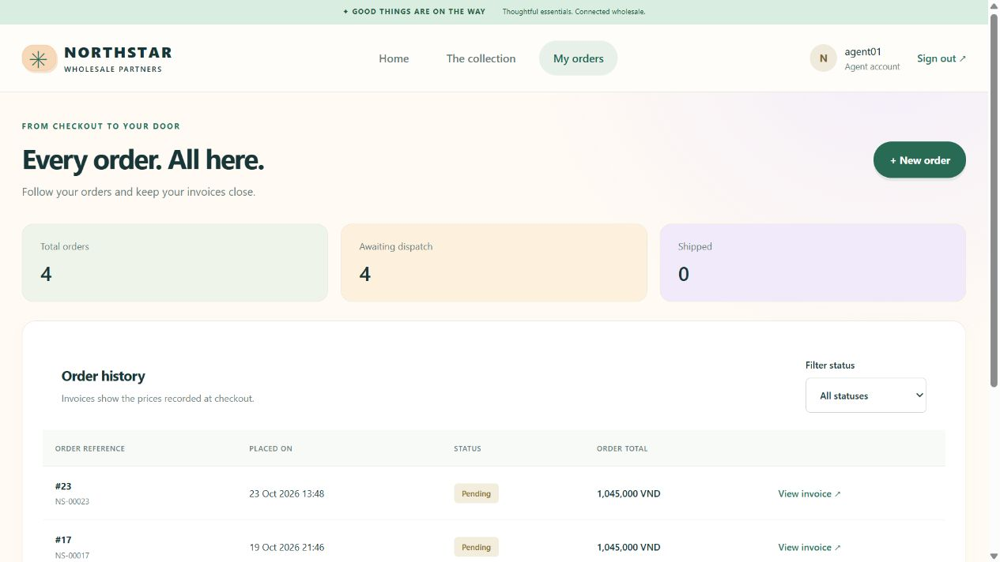

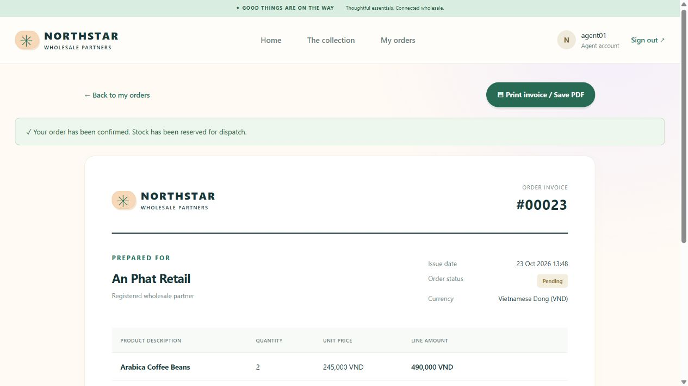

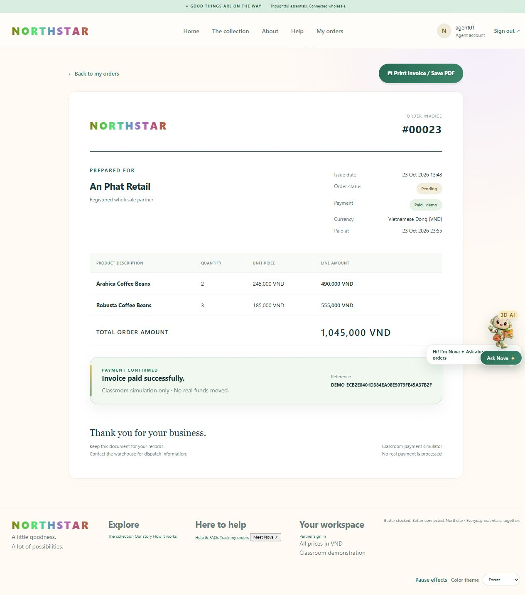

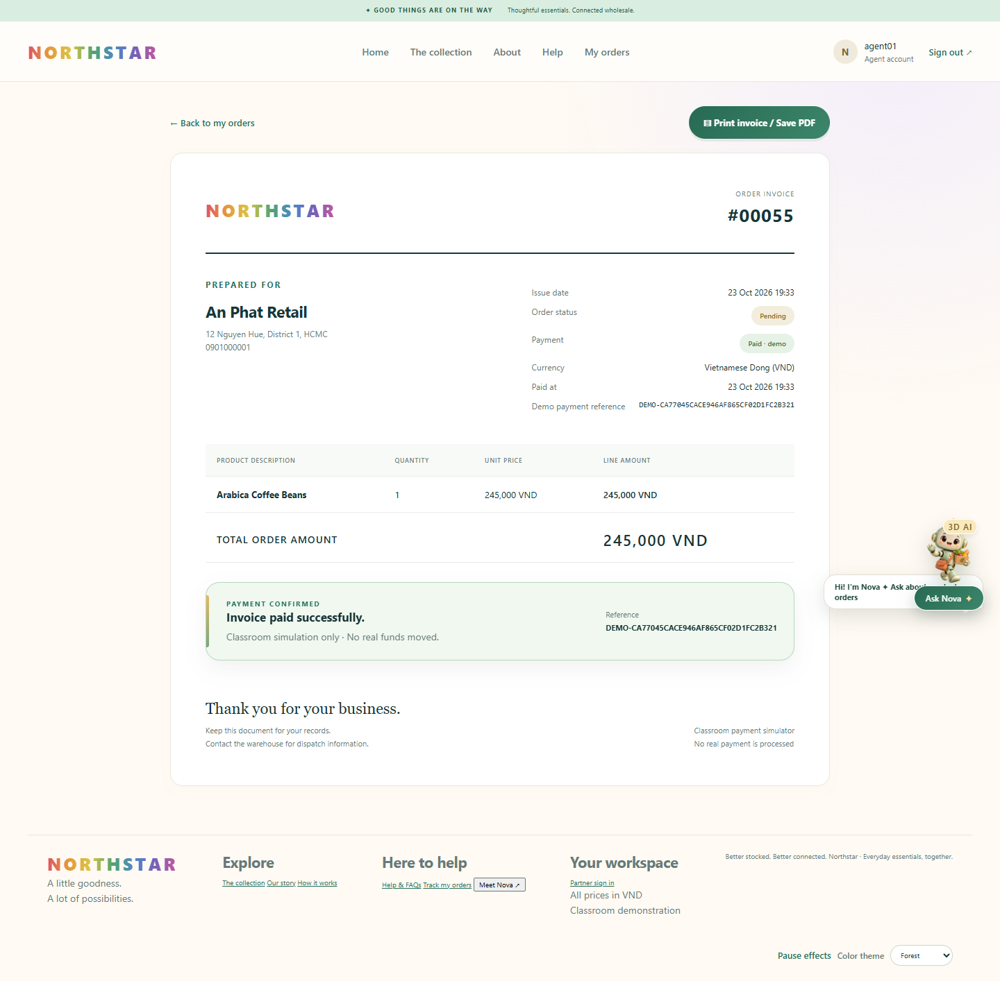

### 5.5 Task 3.4: Responsive UI (5 marks)

The original CSS design system includes responsive navigation, photography cards, list tables, status badges, focus states, errors, empty states and an accessible live summary. Broad hero/category/collection layout inspiration came from the user-supplied MilkyBloom site; no source or brand assets were copied. The local 30-second motion graphic is optional, pausable and respects prefers-reduced-motion. Photography represents ingredients; it does not claim branded package appearance.

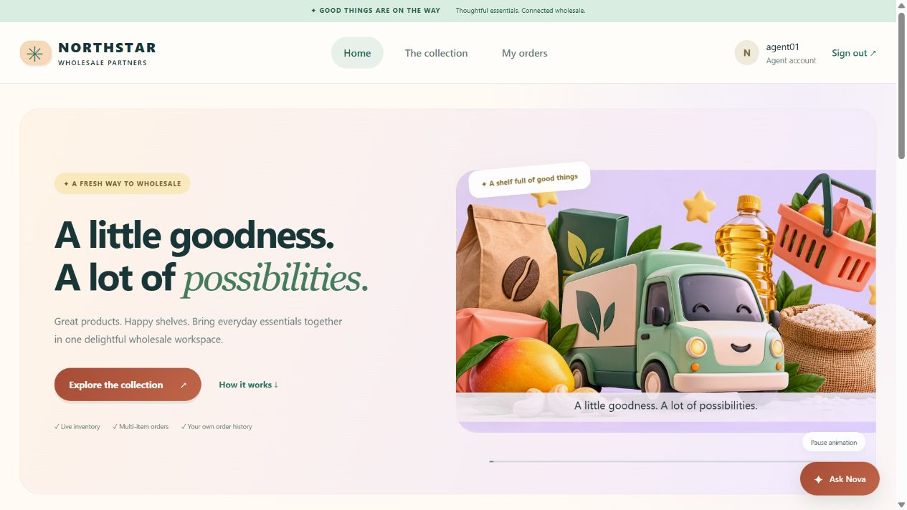

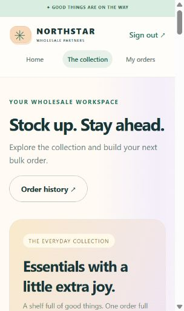

Nova is an optional local AI helper using TF-IDF retrieval and budget/product matching, not a cloud language model. Signed-in recommendations use current SQL prices and positive stock, while history uses the current AgentID. Unknown questions receive a safe fallback. No API key is required; responses cannot place or cancel orders. Forest, Sunset and Lilac themes persist locally. Home category and product links preserve selection through sign-in.

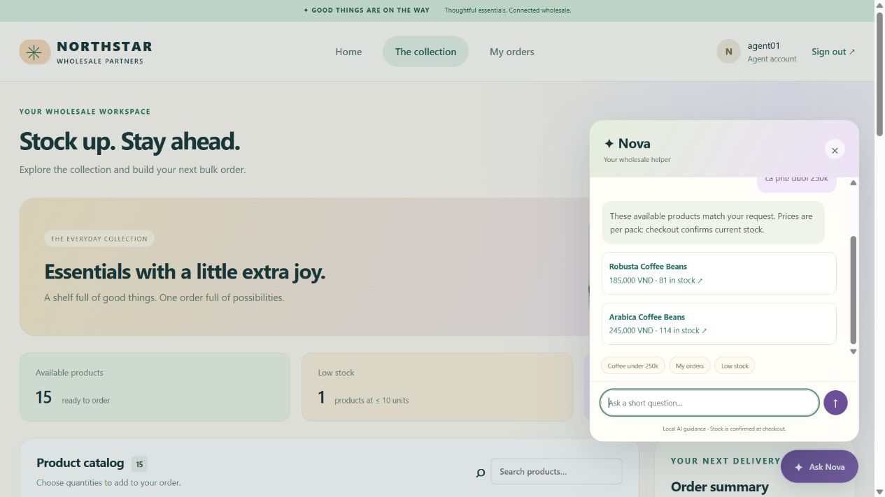

## 6. Exercise 5: Unit Testing (15 marks)

Wholesale.Tests contains 26 meaningful tests; all passed. They cover totals, invalid quantities/prices, exact stock, insufficient stock, immutable deduction, lock threshold, status/cancellation rules and password hash verification, plus local AI normalization, fallback and product recommendation rules.

| Test | Actual result |
|---|---|
| WrongPasswordDoesNotMatch | Passed |
| RejectsEmptyHashPayload | Passed |
| AllowsOnlyValidOrderTransitions | Passed |
| VietnameseProductRecommendationUsesRealPrice | Passed |
| AllowsExactStockAndBlocksOversell | Passed |
| NeverRecommendsUnavailableStock | Passed |
| RejectsNegativePrice | Passed |
| CannotCancelShippedOrder | Passed |
| ZeroStockCannotBeDeducted | Passed |
| UnknownQuestionDoesNotInventAnswer | Passed |
| LocksAtFiveFailedAttempts | Passed |
| RejectsEmptyOrder | Passed |
| DeductsStockWithoutMutatingOriginal | Passed |
| RejectsZeroQuantity | Passed |
| AnswersStockFromSuppliedKnowledge | Passed |
| CorrectPasswordMatches | Passed |
| RejectsUnboundedIterations | Passed |
| RejectsShortPasswordAtCreation | Passed |
| CanCancelOnlyUnshippedOrders | Passed |
| UnderstandsVietnameseWithoutAccentMismatch | Passed |
| RecommendationsRespectBudget | Passed |
| RejectsMalformedBase64 | Passed |
| SaltMakesHashesUnique | Passed |
| CalculatesMasterDetailTotal | Passed |
| EmptyQuestionReturnsSafeFallback | Passed |
| ThrowsWhenDeductionWouldGoNegative | Passed |


The final SQL integration harness passed 46/46 checks with an isolated Chrome checkout, covering role/lockout behavior, registration rollback, master/detail atomicity, mid-transaction rollback, request replay, invoice ownership, payment confirmation and retry, Paid state in history, refund and stock restoration, concurrent last-unit orders, row-version protection, company editing, product deactivation, reports and manifest export. Chrome signed in as a temporary agent, ordered two products, confirmed payment and verified My Orders, A4 invoice output and the 304px layout. The 26/26 unit-test run passed as well. After fixture cleanup, the database contained the same 15 Agents, 15 Items, 19 Orders, 22 OrderDetails and 16 Users as before the run. Evidence is saved in docs/evidence/integration-results.txt and .json, browser-fixture-print.pdf and paid-invoice-print.pdf.

The final interface audit passed 33 Chrome button/route checks on the seeded account and 32 in the isolated checkout, plus 3 native Admin login and 24 dashboard checks. Native editor/details dialogs were opened and dismissed without modifying seed data; SQL fixtures verified the mutation paths. An observed connection timeout was traced to SQL Express AUTO_CLOSE, confirmed by Windows recovery events. Both live lab databases and repeatable setup scripts now set AUTO_CLOSE off. The combined tests passed afterward with a 15-second local connection timeout. Logs are in docs/evidence/*button-audit.json and *smoke.json. Physical printer output is still unverified.

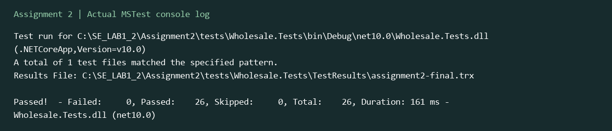

## 7. System Configuration (5 marks)

| Application | External configuration | Reading API |
|---|---|---|
| Admin | App.config / connectionStrings[name=Wholesale] | XML configuration in SqlAdminStore |
| Portal | appsettings.json; ConnectionStrings__Wholesale override | IConfiguration.GetConnectionString |
| SQL harness | Portal config or environment override | ConfigurationBuilder; no hardcoded C# connection |


The classroom connection uses Windows integrated authentication. No real account password or payment secret is embedded. Local Data Protection keys, bin, obj and TestResults folders are excluded from the source package; saved verification evidence remains under docs/evidence.

## 8. Source Control & Teamwork (5 marks)

Confirmed GitHub account: https://github.com/Nghiaktvn. A project repository, real feature branches, student commits, reviews and Pull Requests remain required. Local main has no commits. Workbook branch names are explicitly proposed workflow, not fabricated historical evidence.

## 9. Contribution of Each Member

| Member | Student ID | Actual responsibilities | Contribution |
|---|---|---|---|
| Phạm Trung Nghĩa | 524H0172 | Confirmed submission contact; feature ownership pending group confirmation | Pending |
| Remaining 2–4 members | Not supplied | Group must provide real names and ownership | Pending |


The group must supply actual names, IDs, feature ownership and percentages totaling 100%, matching Readme.txt.

## 10. Conclusion and Lessons Learnt

The dual-platform system has working warehouse and Agent workflows, real SQL persistence, safe master-detail ordering and a coherent visual upgrade. Review found missing Admin lockout, cancellation restoration and stale-stock protection; these were corrected and tested. Physical printing and authentic group collaboration evidence remain manual evidence tasks.

## Appendix A: Readme.txt

NORTHSTAR WHOLESALE — ASSIGNMENT 2
Confirmed member: Phạm Trung Nghĩa — 524H0172
GitHub account: https://github.com/Nghiaktvn
Project repository: pending (an account profile is not a repository/PR record).
Group number, remaining 2–4 real members, actual feature ownership, contribution percentages: pending group confirmation.
Percentages must total 100% and match Report.docx and A2_Team_Workbook.xlsx.
Setup:
1. Install .NET SDK 10 with Windows Desktop and ASP.NET runtimes, and SQL Server.
2. Run database/01_create_database.sql in sqlcmd or SSMS. The script is repeatable and preserves current records.
3. Configure src/Wholesale.AdminWinForms/App.config and src/AgentPortal/appsettings.json.
4. dotnet build WholesaleManagement.sln
5. dotnet run --project src/Wholesale.AdminWinForms
6. dotnet run --project src/AgentPortal --urls http://127.0.0.1:5400
7. dotnet test tests/Wholesale.Tests
8. SQL integration checks: dotnet run --project tests/Wholesale.IntegrationTests -- <absolute Assignment2 directory>
Demo Admin: admin / Demo123!
Demo Agent: agent01@wholesale.local / Demo123!
These are dummy classroom credentials. No public deployment is included.
Portal config supports environment ConnectionStrings__Wholesale.
The SQL harness creates uniquely named fixtures and removes only its own fixtures in finally. Identity values can advance on rollback.
The shipped-revenue dashboard excludes pending and cancelled orders; cancellation restores reservations once only.
30-second MP4/GIF and product photographs are bundled locally; motion can be paused. Photograph licenses/sources are recorded in design documentation.
SourceCode.zip excludes bin, obj, TestResults and local Data Protection keys. Saved evidence is under docs/evidence.
Optional hosted video demo link: pending.


## Appendix B: Generative AI Use (if any)

| Tool / date | Actual request summary | Kept / changed | Validation |
|---|---|---|---|
| Codex / 24 Oct 2026 | Complete PDFs and upgrade all UI/function demos | Domain, SQL, UI, tests and documents | Build; 26 MSTest tests; 46 SQL/browser checks; two-product temporary checkout and paid-invoice PDF |
| image_gen / 23 Oct 2026 | Joyful 3D grocery delivery scene | Original artwork + timed motion graphics | Visual inspection and 30-second metadata |
| Plugin discovery / 23 Oct 2026 | Use tools such as Figma | Figma suggested; no connection confirmed; importable SVG supplied | No Figma file edit claimed |


Photo source/license links and original art prompts are recorded in the design folder. The video is a silent motion graphic with camera movement over original 3D art and three timed captions, not a claim of generated character-motion footage.
